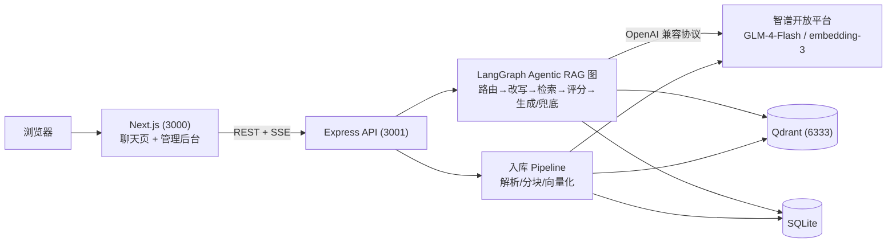

# 模块文档索引

基于 Agentic RAG 的知识库智能客服系统：支持文档/网页/FAQ 三类知识源入库，提供多轮对话（混合检索 + 查询改写 + 评分闭环 + 引用溯源）与可视化的 Agent 思考过程。pnpm monorepo，单机部署。

## 架构总览



## 模块文档导航

| 文档 | 模块 | 一句话职责 | 源码路径 |
|---|---|---|---|
| [shared.md](./shared.md) | @rag/shared | 前后端共享 zod schema 与类型 | packages/shared |
| [server-core.md](./server-core.md) | 服务端基础设施 | env 校验/日志/数据库/向量库/LLM 工厂 | apps/server/src/{config,logger,db,qdrant,llm} |
| [ingest.md](./ingest.md) | 知识入库 | 解析/分块/双路向量化/异步队列 | apps/server/src/ingest |
| [retrieval.md](./retrieval.md) | 混合检索 | dense+BM25 RRF 融合检索 | apps/server/src/retrieval |
| [graph.md](./graph.md) | Agentic RAG 图 | LangGraph 状态机与流式映射 | apps/server/src/graph |
| [api.md](./api.md) | HTTP API | REST + SSE 路由 | apps/server/src/routes |
| [web.md](./web.md) | Web 前端 | 聊天与管理后台 | apps/web |

## 快速上手

前置要求：Node.js ≥ 20、启用 corepack（pnpm@11.25.0）。

```bash
# 1. 启动存储层（Qdrant）
docker compose up -d

# 2. 安装依赖
corepack pnpm i

# 3. 配置智谱 API Key（参考 .env.example）
#    apps/server/.env 中设置 ZHIPU_API_KEY

# 4. 初始化 SQLite 表结构
corepack pnpm db:push

# 5. 同时启动 web (3000) 与 server (3001)
corepack pnpm dev
```

测试：`corepack pnpm test`（vitest，跑全部 workspace 单测/集成测）。

访问 `http://localhost:3000` 进入聊天页，`http://localhost:3000/admin/documents` 进入管理后台。

## 相关文档

- [设计文档](../superpowers/specs/2026-09-02-rag-customer-service-design.md)——总体架构、技术选型与数据流设计
- [实施计划](../superpowers/plans/2026-09-03-rag-customer-service-implementation.md)——分阶段任务拆解与执行记录
- [评测基线报告](../eval/2026-09-baseline.md)——检索与回答质量的基线评测
