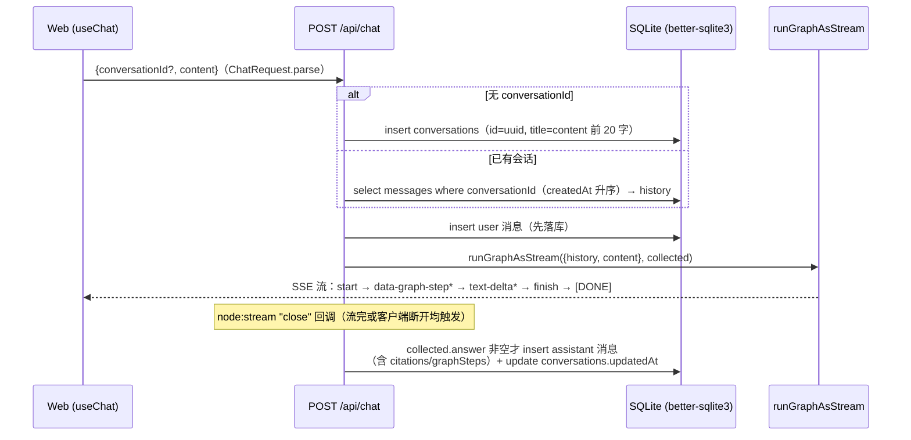

# HTTP API 层（REST + SSE）

> 源码：`apps/server/src/index.ts`、`apps/server/src/routes/`（chat.ts / documents.ts / conversations.ts / retrieval-test.ts）

## 职责与边界

Express 5 HTTP 入口：文档/FAQ 管理、检索效果测试、会话管理（REST），以及核心的 `POST /api/chat`——调用 `runGraphAsStream` 把 LangGraph 图执行以 UIMessage Stream（SSE）流式返回，并在流结束后整轮落库。业务逻辑均在下游模块（graph / ingest / retrieval / db），路由层只做契约校验（zod）、编排与桥接。

## 组成（文件清单）

| 文件 | 职责 |
|---|---|
| `apps/server/src/index.ts` | 中间件、路由挂载、启动序（`ensureCollection` → `listen`） |
| `apps/server/src/routes/chat.ts` | SSE 问答核心（会话建立/历史加载/落库） |
| `apps/server/src/routes/documents.ts` | 文档上传/URL 导入/删除/分块预览 + FAQ CRUD |
| `apps/server/src/routes/conversations.ts` | 会话列表/详情（含消息）/级联删除 |
| `apps/server/src/routes/retrieval-test.ts` | 混合检索效果测试 |

## 接口总表

入参 schema 定义在 `packages/shared/src/index.ts`。全局中间件：`cors({ origin: env.WEB_URL })`（默认 `http://localhost:3000`）、`express.json({ limit: "2mb" })`。

| 方法 | 路径 | 入参（zod） | 出参 | 成功状态码 |
|---|---|---|---|---|
| GET | `/api/health` | — | `{status:"ok", time}` | 200 |
| GET | `/api/documents` | — | `DocumentDto[]`（createdAt 倒序） | 200 |
| POST | `/api/documents/upload` | multipart `file` 字段（multer） | `{documentId}` | **202**（摄取异步） |
| POST | `/api/documents/url` | `UrlImportRequest {url: z.string().url()}` | `{documentId}` | 202 |
| DELETE | `/api/documents/:id` | — | 空 body | **204** |
| GET | `/api/documents/:id/chunks` | — | `{seq, content, tokenCount}[]`（seq 升序） | 200 |
| POST | `/api/documents/faqs` | `FaqInput {question, answer}`（均 min 1） | `{documentId}` | 202 |
| GET | `/api/documents/faqs` | — | `DocumentDto[]`（仅 sourceType=faq） | 200 |
| PUT | `/api/documents/faqs/:id` | `FaqInput` | `{documentId}`（**新 id**，删旧建新） | 202 |
| POST | `/api/retrieval/test` | `RetrievalTestRequest {query, topK: int 1..20 默认 5}` | `{chunkId, docTitle, score, preview}[]` | 200 |
| POST | `/api/chat` | `ChatRequest {conversationId?, content(min 1)}` | UIMessage Stream（SSE） | 200 |
| GET | `/api/conversations` | — | `ConversationDto[]`（updatedAt 倒序） | 200 |
| GET | `/api/conversations/:id` | — | `ConversationDto & {messages: MessageDto[]}` | 200 / **404** |
| DELETE | `/api/conversations/:id` | — | 空 body | 204 |

错误状态码：400 仅在 upload 路由手写返回（缺 `file` 字段 / MIME 不在白名单）；404 仅会话详情（`{error:"会话不存在"}`）；**其余异常（含 ZodError）一律 500**——见「已知坑」。

### 核心 DTO（`packages/shared/src/index.ts`）

| DTO | 字段 |
|---|---|
| `DocumentDto` | `id`、`title`、`sourceType: "file"\|"url"\|"faq"`、`sourceRef`、`status: "processing"\|"ready"\|"failed"`、`error: string\|null`、`chunkCount`、`createdAt`（ISO 字符串） |
| `ConversationDto` | `id`、`title`、`createdAt`、`updatedAt`（均 ISO 字符串） |
| `MessageDto` | `id`、`role: "user"\|"assistant"`、`content`、`citations: Citation[]\|null`、`graphSteps: GraphStep[]\|null`、`createdAt` |
| `Citation` | `n`、`chunkId`、`docTitle`、`sourceRef`、`preview`（120 字） |
| `GraphStep` | 7 种节点变体的联合类型（见 `docs/modules/graph.md` 状态通道一节） |

documents 路由的 `toDto` 把 drizzle 行的 `createdAt`（`timestamp_ms` 模式 → Date）转 ISO 字符串、`error` 可空；conversations 路由的 `toConv` 同理。

## POST /api/chat 详解

### 请求契约与跨端适配

后端契约：`ChatRequest = z.object({ conversationId: z.string().optional(), content: z.string().min(1) })`。

前端 `useChat` + `DefaultChatTransport` 默认发送的是 `{id, messages, trigger}`，与后端契约不同。适配在 `apps/web/app/page.tsx` 的 `prepareSendMessagesRequest`：取最后一条 user 消息的 text parts 拼接映射为 `content`；`conversationId` 经 `sendMessage({text}, { body: { conversationId: activeId } })` 的 per-call body 合并进请求（transport 为模块级单例，因 useChat 的 Chat 实例首渲染构造后永久持有 transport）。无激活会话时为 `undefined`，`JSON.stringify` 省略该字段 → 后端新建会话。

### 处理流程



桥接细节：`createUIMessageStreamResponse({ stream })` 产出 undici `Response`，其 `body` 经 `Readable.fromWeb(response.body as any).pipe(res)` 写入 Express 响应（undici 与 `node:stream/web` 的 ReadableStream 类型声明不一致，需断言）；状态码与响应头（`content-type: text/event-stream`、`x-vercel-ai-ui-message-stream: v1`、`cache-control: no-cache`、`x-accel-buffering: no`）从 Response 复制到 `res`。

### SSE wire 协议（真实事件序列样例）

每个 UIMessageStreamPart 序列化为一条 `data: {JSON}`，流尾 `data: [DONE]`（由 ai 包的 `JsonToSseTransformStream` 生成）：

```
data: {"type":"start","messageId":"7f9c…"}

data: {"type":"start-step"}

data: {"type":"data-graph-step","id":"a1b2…","data":{"node":"router","summary":"意图：知识问题"}}

data: {"type":"data-graph-step","id":"c3d4…","data":{"node":"rewrite","data":{"queries":["退货政策是什么","退货政策 变体"],"round":1}}}

data: {"type":"data-graph-step","id":"e5f6…","data":{"node":"retrieve","data":{"queries":["退货政策是什么","退货政策 变体"],"candidates":2}}}

data: {"type":"text-start","id":"9a8b…"}

data: {"type":"text-delta","id":"9a8b…","delta":"退货需在签收后 7 天内发起 [1]"}

data: {"type":"text-end","id":"9a8b…"}

data: {"type":"finish-step"}

data: {"type":"data-citations","id":"d1c2…","data":[{"n":1,"chunkId":"c1","docTitle":"退货政策","sourceRef":"a.pdf","preview":"…前 120 字…"}]}

data: {"type":"finish","finishReason":"stop"}

data: [DONE]
```

注意 `text-delta` 的增量字段名是 **`delta`** 而非 `text`（AI SDK v5）。图执行抛错时 `onError` 兜底映射为：

```
data: {"type":"error","errorText":"服务暂时不可用：<底层错误信息>"}
```

前端 useChat 将其转为 `error.message` 展示（「服务暂时不可用：…」）。此路径 `collected.answer` 为空 → assistant 消息不落库（user 消息已落库，存在单向消息）。

## documents 路由

- **上传**：multer `memoryStorage()` + `limits.fileSize = MAX_FILE_BYTES`（20MB）；handler 内对 `ALLOWED_MIME`（pdf / docx / txt / markdown）做**二次校验**——multer 只限大小不过滤 MIME。校验失败显式 400；通过后插入 documents 行（status 默认 `processing`）并 `enqueueIngest`（PQueue，concurrency 2，立即返回不阻塞）→ **202 + `{documentId}`**。状态经 `GET /api/documents` 轮询：`processing → ready | failed`（失败带 error）。
- **URL 导入**：`UrlImportRequest` 校验 url；title 取 `hostname + pathname`；异步 `enqueueIngest({documentId, url})` → 202。
- **FAQ CRUD**：复用 documents 表（`sourceType="faq"`，title=question，sourceRef 空串），`ingestFaq` 以「Q\nA」单块入库。**PUT `/faqs/:id` 是删旧建新语义**：先 `deleteDocumentFully(旧id)`（SQLite 级联 + Qdrant filter 删除 + BM25 df 回退），再插入新行 → 返回**新 documentId**，前端须以新 id 刷新。
- **删除**：`deleteDocumentFully(req.params.id)`，路由 await 其完成（Qdrant `wait: true`）后 204；幂等（id 不存在不报错）。
- **分块预览**：`GET /:id/chunks` 按 seq 升序返回 `{seq, content, tokenCount}`。
- **路由顺序自查结论**：单段 GET 仅 `/`（列表）与 `/faqs`，均为字面量；`GET /:id/chunks` 为两段模式且与 `PUT /faqs/:id` 方法不同 → **无互抢**，注册顺序无影响。

## conversations 路由

- **列表**：`GET /` 按 `updatedAt` 倒序（侧栏最近会话在前）。
- **详情**：`GET /:id` 会话不存在返回 404；messages 按 `createdAt` 升序。`citations`/`graphSteps` 是 drizzle `mode:"json"` 列，读出即已解析的对象（路由仅 `?? null` 断言为 `Citation[] | null` / `GraphStep[] | null`）。
- **删除**：`db.delete(conversations)`，messages 外键 `onDelete: "cascade"` 级联删除；无存在性检查，幂等 204。

## retrieval-test 路由

`POST /api/retrieval/test`：入参 `RetrievalTestRequest { query(min 1), topK: int 1..20 默认 5 }`；直接调 `hybridSearch(query, topK)`（dense+BM25 双路 RRF），出参为命中数组 `{ chunkId, docTitle, score, preview: content.slice(0, 120) }`。用于管理端调试检索效果，不经过图。

## 实现细节与已知坑

1. **无全局错误中间件**：所有 handler 都是 async，`ChatRequest.parse` 等抛出的 `ZodError`（请求体不合法）或任何下游异常会进入 Express 5 默认错误处理 → **500 HTML 而非 400/422 JSON**。当前仅 upload 路由手写了 400。校验失败的具体信息不透出给客户端。
2. **CORS 锁定**：`cors({ origin: env.WEB_URL })`，仅前端来源可调；其他来源的浏览器请求被拒。
3. **落库在 close 回调**：assistant 消息与 `conversations.updatedAt` 在 `Readable.fromWeb(...)` 的 **`close` 事件**回调中写入（流正常结束或客户端断开都会触发）；better-sqlite3 为同步驱动，语句以 `.run()` 立即执行，`citations`/`graphSteps` 为 json mode 列直接传数组。**`collected.answer` 为空（错误路径）不落库**，但 user 消息已先落库。
4. `express.json` 上限 2mb（不影响 URL 导入——抓取发生在服务端 ingest，上限 5MB/15s 超时）。
5. 202 语义：upload/url/FAQ 写入返回 202 只代表「已入队」，摄取结果需轮询文档列表；PUT faqs 返回的新 documentId 与路径 :id 不同。

## 启动流程（index.ts）

`type: "module"` 顶层 await 序：`dotenv/config` → 实例化 app、挂 `cors` + `express.json` → 注册 `GET /api/health` → 依次挂载 `/api/documents`、`/api/retrieval/test`、`/api/chat`、`/api/conversations` → **`await ensureCollection()`**（幂等创建 Qdrant 集合 `kb_chunks`：dense 1024 维 Cosine + sparse）→ `app.listen(env.PORT)`（默认 3001）。集合创建失败（Qdrant 不可达）则进程启动失败。

## 测试与验证

routes 层无独立单测（无 supertest 覆盖），验证依赖：graph 集成测试（见 `docs/modules/graph.md`，覆盖 chat 路由所调用的 `runGraphAsStream` 全路径）、ingest/retrieval 等下游单测、以及前端联调（`pnpm --filter web dev` + server dev）。手动冒烟：`curl http://localhost:3001/api/health`；SSE 可用 `curl -N -X POST :3001/api/chat -H "content-type: application/json" -d '{"content":"退货政策是什么"}'` 观察 `data:` 事件序列。
